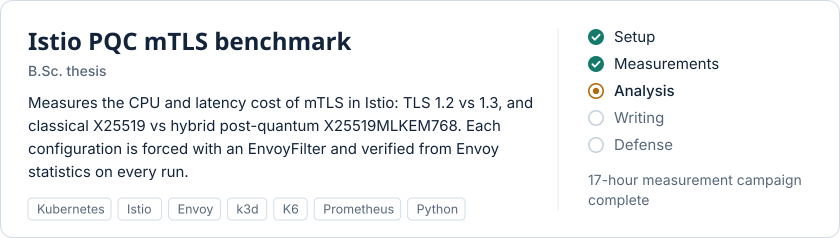
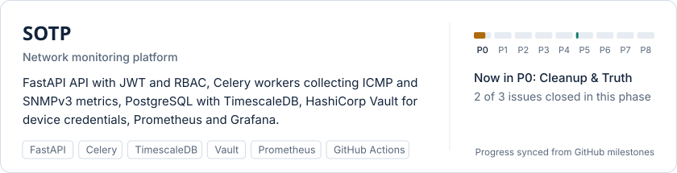

<picture>
  <source media="(prefers-color-scheme: dark)" srcset="assets/header-dark.svg">
  
</picture>

## Projects

<a href="https://github.com/Kacper-Slezak/Thesis_PQC">
  <picture>
    <source media="(prefers-color-scheme: dark)" srcset="assets/thesis-dark.svg">
    
  </picture>
</a>

<a href="https://github.com/Kacper-Slezak/SOTP">
  <picture>
    <source media="(prefers-color-scheme: dark)" srcset="assets/sotp-dark.svg">
    
  </picture>
</a>

**[Entry System](https://github.com/Kacper-Slezak/Entry_System)** — two-factor access control  
QR code + face verification (DeepFace, Facenet512), FastAPI, PostgreSQL, Docker Compose. CI runs on mocked face embeddings.

**[ThreatLens](https://github.com/Sullyvahnn/HackYeah)** — HackYeah 2025  
Map of reported threats built in 24h; article classification and deduplication with the Groq and Gemini APIs.

**[Packet classification](https://github.com/Martynka123-code/Online-machine-learning-based-packet-classification-project)** — team project  
Real-time traffic classification on live captures: flow-based Random Forest vs byte-level CNN.

## Tech
| | |
|---|---|
| Languages | Python · Bash |
| Containers & orchestration | Docker · Kubernetes · k3d |
| Service mesh | Istio · Envoy |
| Observability | Prometheus · Grafana · TimescaleDB |
| Backend & data | FastAPI · SQLAlchemy · Celery · PostgreSQL · Redis |
| CI/CD & security | GitHub Actions · HashiCorp Vault · Bandit |

[LinkedIn](https://www.linkedin.com/in/kacper-%C5%9Bl%C4%99zak-739a20285/) · kacper.slezak.cv@gmail.com

Images are generated from [`profile/config.toml`](profile/config.toml) by a daily GitHub Action; SOTP progress is read from its milestones.
